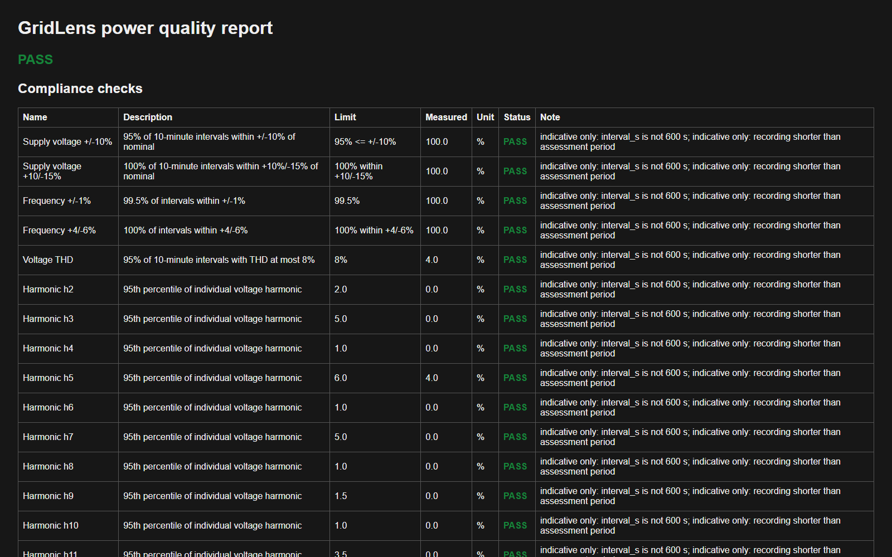

# GridLens

[](https://github.com/bhuvi-777/gridlens/actions/workflows/tests.yml)
[](LICENSE)



Vendor-neutral Python power-quality analysis, standards checks, and reports from waveform files.

## Quickstart

From a clone of this repository, run these three commands:

```powershell
python -m pip install -e ".[dev]"
gridlens generate demo.csv --duration 60 --harmonic 5=0.04
gridlens analyze demo.csv --interval 10 --report report.html
```

The generated report is indicative for this short demo recording. For a full
assessment, use an appropriately long recording and verify results against the
official standard and certified instruments.

## Why GridLens?

Power-quality tools are often tied to a particular instrument. GridLens aims
to provide a free, scriptable layer for analyzing waveform data from multiple
sources, with reusable metrics, event detection, standards checks, and reports.

## Python example

```python
from gridlens.generator import sine_wave
from gridlens.metrics import power_factor, rms, thd

t, v = sine_wave(rms=230, harmonics={5: 0.08})   # 230 V with 8 % 5th harmonic
_, i = sine_wave(rms=10, phase=-0.5)             # 10 A, lagging

print(f"Voltage RMS:  {rms(v):.1f} V")
print(f"Voltage THD:  {thd(v, fs=10_000):.2%}")
print(f"Power factor: {power_factor(v, i):.3f}")
```

Load your own data:

```python
from gridlens.loaders import load_csv

wave = load_csv("capture.csv", voltage_col="v", current_col="i", fs=10_000)
```

## Roadmap

- [x] Synthetic waveform generator
- [x] RMS, THD, active/reactive/apparent power, power factor
- [x] CSV loader
- [x] Sag, swell and interruption detection
- [x] EN 50160 and IEEE 519 voltage compliance checks
- [ ] Indian grid code limits
- [x] COMTRADE loading (optional `comtrade`)
- [x] HTML compliance reports
- [x] Command-line tool
- [ ] PDF report and web UI

## Analyze a file

```powershell
gridlens analyze capture.csv --standard en50160 --nominal 230 --freq 50
gridlens analyze capture.csv --standard ieee519 --bus-kv 11 --report report.html
```

## Standards supported

| Standard | Status |
| --- | --- |
| EN 50160 | Implemented for LV voltage, frequency, THD and harmonics |
| IEEE 519-2014/2022 | Voltage distortion implemented; current TDD planned |
| India CEA/grid code | Planned; limits are not implemented |

> Engineering guidance only. Compliance claims must be verified against the
> official standard text and edition, applicable system scope, and certified instruments.

## Contributing

Issues and pull requests are welcome. See [CONTRIBUTING.md](CONTRIBUTING.md)
for setup and contribution steps. Pull requests must pass CI before merging.

## License

MIT